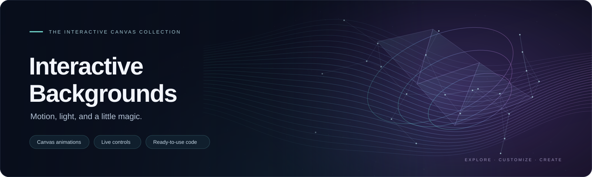

# Interactive Backgrounds

A collection of animated HTML Canvas backgrounds with mouse interaction, optional live settings editors, and a gallery for switching between scenes.

Each background is standalone and uses plain HTML, CSS, and JavaScript. No framework, build step, or external JavaScript dependency is required.

## Configurator
Explore, customize, and preview animated backgrounds using the interactive configurator. Once you're satisfied with your design, you can download the fully configured, ready-to-use source code.

[Try the Interactive Background Configurator](https://curiousmaster.github.io/Interactive_Backgrounds/)

## Background collection

| Background | Effect |
| --- | --- |
|Blob Grid|A field of luminous dots swells into soft, shifting blobs, turning a simple grid into a living surface.|
|Wave Field|Gentle waves travel across a field of points, creating a rolling landscape of light.|
|Magnetic Particles|A cloud of glowing particles responds to magnetic forces, gathering and scattering around your pointer.|
|Topographic Contours|Fine contour lines trace an evolving landscape, revealing flowing ridges and valleys.|
|Aurora Ribbons|Curtains of luminous color drift through the darkness like an abstract northern sky.|
|Elastic Mesh|A delicate mesh stretches and relaxes as your pointer disturbs its woven surface.|
|Constellation Network|Drifting stars form fleeting connections, creating a constellation that continually redraws itself.|
|Liquid Interference|Overlapping waves create liquid patterns, bright seams, and shifting pockets of color.|
|Scanning Light|Bands of light sweep across the surface, revealing details before they disappear into darkness.|
|Flowing Glyphs|Streams of glowing glyphs flow through the scene, creating a quiet, digital atmosphere.|
|Orbital Trails|Luminous paths curl around invisible centers, leaving graceful traces of their motion.|
|Impossible Windows|Floating windows reveal fragments of alternate motion, layering different rhythms within one scene.|
|Memory Fossils|Crystal-like traces emerge and age into delicate fossils, preserving echoes of your interaction.|
|Shadow Organisms|Soft shadow creatures drift across the surface, retreating from the light around your pointer.|
|Woven Time|Interlaced threads carry different rhythms, weaving a fabric that settles into harmony nearby.|
|Borrowed Dimensions|Geometric forms shift between shapes and dimensions, creating a gently unfolding spatial illusion.|
|Living Atlas|Contours, particles, memories, and flowing light share a living landscape that responds to exploration.|
|Glass Tides|Translucent glass plates drift above a hidden pattern, bending its appearance as they shift and tilt.|
|Echo Architecture|Wireframe structures unfold and dissolve, suggesting impossible buildings suspended in darkness.|
|Chromatic Faults|Fine fractures carry pulses of color through branching paths; your pointer bends their course.|
|Paper Weather|Folded shapes float through gentle gusts, tumbling and opening as your pointer stirs the air.|
|Signal Archaeology|Broken waveforms and scattered diagrams drift through darkness. Move nearby to tune them into clarity.|
|Prismatic Rain|Falling strokes of light split into spectral trails as they cross prism bands. Your pointer becomes another prism.|
|Breathing Caverns|Layers of illuminated cave walls breathe around a dark opening. Move your pointer to reveal their depth.|
|Clockwork Garden|Fine stems grow into rotating gears and geometric flowers, then retract. Your pointer awakens nearby mechanisms.|
|Negative Constellations|Dark openings drift through a luminous field, joined by shadow lines. Your pointer parts them to reveal light.|
|Velvet Vortices|Soft strokes follow wandering vortices like brushed velvet. Move your pointer to comb the surface and leave a fading impression.|
|Luminous Sediments|Glowing grains settle into layered dunes. Gentle currents loosen them, while your pointer lifts them into drifting clouds.|
|Origami Horizons|Translucent triangular folds lift and settle into an abstract landscape. Your pointer raises nearby ridges.|
|Orbiting Silence|Fine arcs orbit invisible centers and briefly align. Your pointer gathers nearby arcs into a temporary orbit.|
|Capillary Light|Luminous ink spreads through branching channels, blending where colors meet. Your pointer feeds fresh color into the network.|
|Mirage Loom|Fine stripe layers slide across one another, forming shifting moir\u00e9 patterns. Your pointer bends the weave like a lens.|
|Floating Tesserae|Translucent mosaic tiles drift apart and reassemble into flowing patches of color. Your pointer opens a gap that gently closes behind it.|
|Resonant Pools|Ripples from scattered pools reinforce and cancel one another, forming bright seams. Your pointer adds a source to reshape the pattern.|
|Solar Herbarium|Translucent leaves slowly unfurl as moving light reveals their veins. Your pointer illuminates the foliage like a soft spotlight.|
|Phase Lanterns|Floating halos morph between rings, polygons, and interrupted loops. Your pointer draws nearby lanterns into a shared rhythm.|

## Project layout

Each background directory contains two files:

- `index.html`: animation, styles, and permanent configuration.
- `settings-editor.js`: optional settings pane, editor styles, and configuration export.

The parent directory also contain:

- `index.html`: background selection gallery.
- `example.html`: an example content page with a fixed animated background.
- `README.md`: this documentation.

Folder names are configurable. The gallery's example names are not automatically discovered: update its `backgrounds` array to match your actual directories.

## Run locally

From the project directory, start a static server. For example, with Python installed:

```bash
python3 -m http.server 8000 --bind 127.0.0.1
```

On Windows, you can use:

```powershell
py -m http.server 8000 --bind 127.0.0.1
```

Open `http://localhost:8000/` for the gallery, or open a background directly:

```text
http://localhost:8000/constellation-network/index.html
```

Use HTTP or HTTPS rather than double-clicking the HTML file. The optional editor uses a JavaScript module import, which may be blocked when opened through `file://`.

## Live settings editor

Enable the editor in the background's configuration:

```javascript
panel: {
    enabled: true
}
```

Click **Settings** to open the pane. Controls update the animation immediately. Use **Retract** or Escape to close it.

Available controls depend on the background. They include colors, particle or blob counts, movement speed, geometry, mouse behavior, glow, and rendering detail. Some geometry changes rebuild the scene, and reset or clear buttons are available in selected editors.

RGB colors use arrays with values from 0 to 255:

```javascript
color: [80, 160, 255]
```

### Save permanent settings

1. Adjust the controls.
2. Click **Show code** to inspect the current configuration.
3. Click **Copy config**.
4. Replace the complete `const config = { ... };` block in that background's `index.html`.
5. Save the file and reload the page.

Editor changes are held in memory until you save the exported configuration. They are not automatically written to disk or retained after a reload.

If clipboard access is unavailable, the editor selects the configuration text for manual copying with Ctrl+C or Command+C.

### Production mode

Set the following in the saved configuration:

```javascript
panel: {
    enabled: false
}
```

The editor module is then not imported. You can deploy only the background's `index.html` if you do not need its editor.

Copy your settings before turning off the pane through its own checkbox: doing so hides the editor controls immediately.

## Background gallery

The parent `index.html` loads one selected background in a fullscreen iframe. A transparent central panel provides selection, a hide/show control, and a link to open the background separately.

Configure its folder mapping:

```javascript
const backgrounds = [
    { name: "Constellation Network", folder: "constellation-network" },
    { name: "Living Atlas", folder: "living-atlas" }
];
```

The gallery remembers the selected folder using local storage when available. This saves the selection, not the background's live editor settings.

To see the animation clearly through the panel, avoid backdrop blur:

```css
.panel {
    background: rgba(0, 0, 0, 0.12);
    backdrop-filter: none;
    -webkit-backdrop-filter: none;
}
```

Use `background: transparent` for a completely transparent panel.

## Use a background on your own page

Start with `example.html` and change its folder setting:

```javascript
const backgroundFolder = "constellation-network";
```

Replace the section marked **INSERT YOUR OWN HTML HERE** with your own content. The example includes placeholder text and a transparent content panel.

The background iframe stays fixed while the page content scrolls. Content sits above the animation using these layers:

```css
#animated-background {
    position: fixed;
    inset: 0;
    width: 100%;
    height: 100%;
    border: 0;
    z-index: 0;
}

.page {
    position: relative;
    z-index: 1;
    pointer-events: none;
}

.content {
    pointer-events: auto;
    background: rgba(0, 0, 0, 0.12);
}
```

Empty areas of the page allow pointer interaction with the iframe. Content panels receive pointer events normally so text, links, and controls remain usable. The animation does not receive cursor movement through those panels.

The supplied example deactivates background cursor effects when the pointer enters a content panel. This requires the page and background to be served from the same origin.

For a purely decorative background, set `pointer-events: none` on the iframe. This disables direct mouse interaction with it.

## Living Atlas interaction

- Move the cursor to raise a terrain hill and emit ripples.
- Linger or click to plant a crystalline memory.
- Watch network nodes follow currents derived from the shared terrain field.
- An aurora scan briefly unfolds nodes into small geometric fragments.
- Crystals grow, change color, and eventually fade into dust.

Individual layers can be disabled in the editor. Memory is temporary and is cleared when the background reloads.

## Performance

Rendering cost depends on viewport size and settings. For smoother animation:

- Increase grid spacing or terrain sampling spacing.
- Reduce particle, node, ribbon, or fragment counts.
- Reduce connection distances in network scenes.
- Disable glow or lower its blur.
- Increase pixels per sample in Liquid Interference.
- Reduce window count in Impossible Windows; overlap combinations increase rendering work.
- Reduce crystal branching depth and memory limits.

The gallery replaces its iframe source when switching backgrounds, so only the selected scene remains loaded.

## Troubleshooting

| Problem | Check |
| --- | --- |
| Background does not load | Verify the folder name and that its `index.html` URL opens directly. |
| Settings pane does not appear | Enable `panel.enabled`, confirm `settings-editor.js` is beside the background, and use HTTP/HTTPS. |
| Module import fails | Check the browser console, filename case, and that the server serves JavaScript with an appropriate MIME type. |
| Panel obscures animation | Lower the panel background opacity and remove backdrop blur. |
| Mouse effects stop over content | Foreground content receives pointer events; this is expected with iframe integration. |
| Settings disappear after refresh | Export and save the configuration in the background's `index.html`. |
| Animation feels slow | Reduce scene complexity or increase sampling/grid spacing. |

## Browser behavior

The scenes use Canvas 2D and the editors use dynamic JavaScript module imports. Some effects also use canvas filters. Check your target browsers and devices before deployment.

The existing animations do not automatically stop when reduced motion is requested; reduced-motion styling applies to editor transitions in the supplied examples. For accessibility-sensitive pages, add a static alternative or an explicit animation toggle.

## License

This project is licensed under the Apache License, Version 2.0. You are free to use, modify, and distribute the software in accordance with the terms of the license. See the [LICENSE](LICENSE) file for full details.
